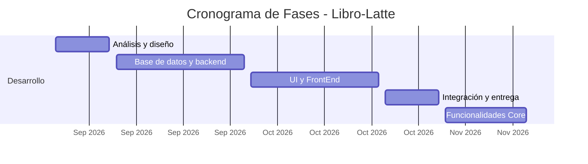
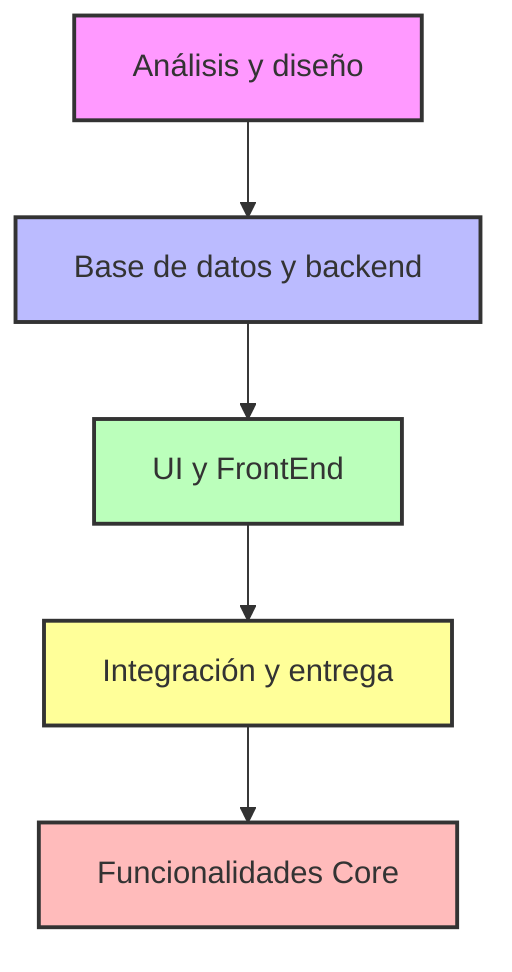

## Cronograma del Proyecto (Libro-Latte)

### Detalle de Fases y Fechas
1. Análisis y diseño: 01/09/2026 – 09/09/2026
2. Base de datos y backend: 10/09/2026 – 29/09/2026
3. UI y FrontEnd: 30/09/2026 – 19/10/2026
4. Integración y entrega: 20/10/2026 – 28/10/2026
5. Funcionalidades Core: 29/10/2026 – 10/11/2026

## Diagrama PERT - Red de Dependencias (Libro-Latte)

